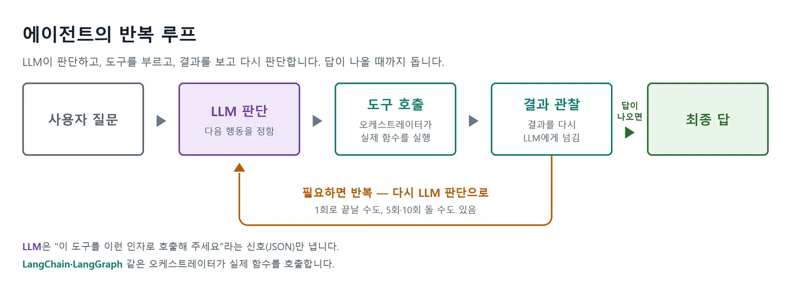

# AI 에이전트 개념

# AI 에이전트란 무엇인가

<aside>
📌

- "챗봇", "RAG", "AI 에이전트"가 어떻게 다른지
- 에이전트의 정의 — **LLM + 도구 + 반복**
- ReAct 패턴의 흐름(Thought → Action → Observation → Answer)
- 에이전트의 모든 기능이 LLM일 필요는 없는 이유 — **하이브리드 구조**
- 왜 2024~2026이 본격적인 "에이전트의 해"가 되었는지
- 이 책에서 만들어 볼 에이전트 4가지 미리보기
</aside>

## **챗봇 · RAG · 에이전트**

- **챗봇(Chatbot):** 사용자 질문 → LLM이 학습 데이터만으로 답함. 한번의 입력에 한번의 출력
- **RAG(Retrieval-Augmented Generation, 검색 증강 생성)**: 참고 문서를 찾아 읽음→내용을 근거로 답변
- **에이전트(Agent):** 여러 도구를 골라가며 답이 나올 때까지 반복

| 구분 | 챗봇(Chatbot) | RAG(검색 증강 생성) | AI 에이전트(Agent) |
| --- | --- | --- | --- |
| **한 줄 정의** | LLM이 자기 기억만으로 답함 | LLM이 "참고 문서"를 먼저 읽고 답함 | LLM이 스스로 도구를 골라 여러 번 호출함 |
| **입력 → 출력 횟수** | 1회 | 1회 (검색은 내부 과정) | **여러 회(반복)** |
| **외부 데이터 접근** | 없음 | 내 문서(PDF, DB) 읽기 | 웹검색, API, 파일, DB, 이메일 등 |
| **판단 주체** | 사람이 질문을 설계 | 사람이 검색 범위를 정함 | LLM이 다음 행동을 스스로 결정 |
| **예시** | "파이썬 코드 리뷰해줘" | 사내 규정 Q&A 챗봇 | "최근 뉴스 3건 요약해 메일로 보내줘" |

## 에이전트

> **AI 에이전트 = LLM + 도구(Tools) + 반복(Loop)**
> 

**LLM — 사고와 판단을 맡는 두뇌**

다음에 무엇을 할지 결정

**도구(Tool) — LLM이 호출할 수 있는 함수들**

종류: 웹 검색, 계산기, DB 조회, 파일 시스템, API 호출, 사람에게 묻기

**반복(Loop) — 답이 나올 때까지 도는 제어 흐름**

**사람 vs 에이전트**

| 사람 | 에이전트 |
| --- | --- |
| 머릿속 사고 | LLM의 추론(reasoning) |
| 검색·계산기·앱 사용 | 도구(tool) 호출 |
| 결과를 보고 다음 행동 결정 | 관찰(observation) → 다음 사고 |
| 답이 나올 때까지 반복 | 제어 루프(agent loop) |

## ReAct 패턴

> **Reasoning(추론) + Acting(행동)**
> 

거의 모든 에이전트 프레임워크의 기본 뼈대

**ReAct의 4단계 프리미티브**

- **Thought(사고)**: LLM이 현재 상황을 정리하고 다음에 할 일을 머릿속으로 계획합니다.
- **Action(행동)**: 어떤 도구를 어떤 인자로 호출할지 결정해 신호를 냅니다.
- **Observation(관찰)**: 도구가 돌려준 결과를 받아 들이고 정보로 흡수합니다.
- **Answer(답)**: 충분한 정보가 모였다고 판단되면 사용자에게 최종 답을 반환합니다.

## 하이브리드 구조

**LLM:** 판단과 언어 처리 담당
**일반 코드·규칙·도구**: 정확성·재현성이 필요한 작업 담당

| 기능 | 적합한 구현 |
| --- | --- |
| "다음 주 부산 출장비 계산해 줘"
의도 이해 | LLM |
| 직원·출장 규정 조회 | DB/API |
| 숙박비 한도와 교통비 계산 | 일반 코드·규칙 |
| 영수증 항목 추출 | OCR 또는 멀티모달 LLM |
| 규정 위반 여부 판정 | 규칙 엔진 |
| 결과 설명 및 부족한 정보 질문 | LLM |
| 지급 승인 | 승인 워크플로와 담당자 |

정해진 입력을 정해진 순서로 실행 → 워크플로 자동화

 반대로 입력과 상황에 따라 에이전트가 어떤 도구를, 어떤 순서로 쓸지 그때그때 결정 → LLM을 사용하는 AI 에이전트

### 정리

- 에이전트 = **LLM + 도구 + 반복**. 셋 다 있어야 에이전트
- LLM은 두뇌, 도구는 손과 발, 반복은 일을 끝까지 밀고 가는 의지
- ReAct 패턴(Thought → Action → Observation → Answer)이 기본 뼈대, LangChain `create_agent` / LangGraph 가 이를 구현
- 에이전트의 모든 기능이 LLM일 필요는 X **판단은 LLM, 확정적 실행은 코드·규칙·검색**이 맡는 하이브리드 구조가 실무 기본값
- 에이전트는 만능이 X **도구 설계와 사람 확인 단계가 품질을 결정**