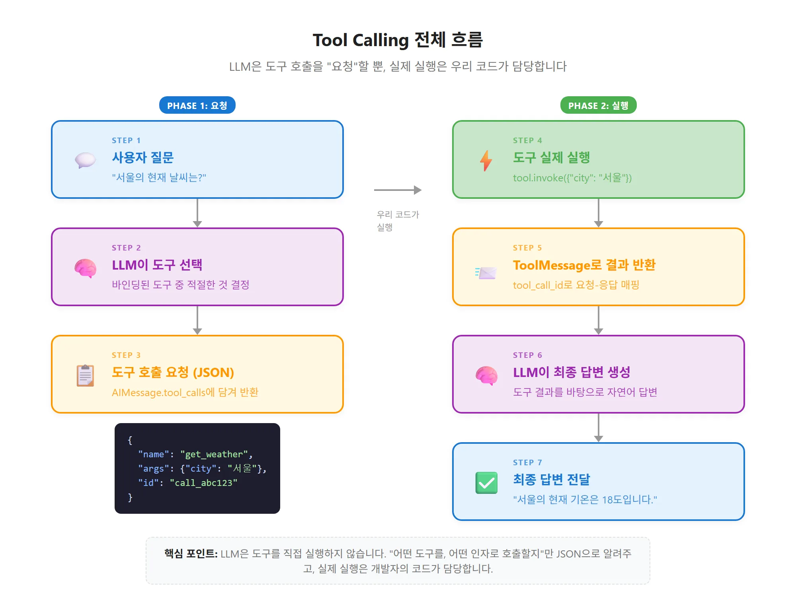

# Tool Calling

# **Ch.05 Tool Calling과 Function Calling**

<aside>
📌

- Tool Calling의 개념과 LLM이 도구를 선택하는 원리를 이해한다
- @tool 데코레이터로 커스텀 도구를 정의한다
- bind_tools()로 모델에 도구를 연결하고 호출 결과를 처리한다
- 내장 도구와 커뮤니티 도구를 활용하는 방법을 익힌다
</aside>

## 도구 호출(Tool Calling)이란?

LLM이 외부 도구(함수, API)를 호출해야 할 때, **어떤 도구**를 **어떤 인자**로 호출할지 결정하는 LLM의 능력

 LLM은 도구를 **직접 실행하지 않음**

"이 도구를 이 인자로 호출해야 한다"는 **구조화된 요청(JSON)**을 반환할 뿐이고, 실제 실행은 우리 코드가 담당

**Tool Calling의 핵심**

1. 도구 바인딩: LLM에게 "이런 도구들이 있어"라고 알려줌
2. 도구 선택: LLM이 사용자 질문을 보고 "이 도구를 이 인자로 호출해줘"라고 요청
3. 도구 실행: 우리 코드가 실제로 도구를 실행하고, 결과를 LLM에게 돌려줌

**Tool Calling의 전체 흐름**

| 단계 | 누가 | 무엇을 |
| --- | --- | --- |
| 1. 도구 정의 | 개발자 | `@tool` 데코레이터로 함수를 도구로 변환 |
| 2. 도구 바인딩 | 개발자 | `model.bind_tools([tool1, tool2])`로 모델에 연결 |
| 3. 모델 호출 | LLM | 사용자 질문을 분석하고 적절한 도구와 인자를 선택 |
| 4. 도구 실행 | 우리 코드 | `tool.invoke(args)`로 선택된 도구를 실제 실행 |
| 5. 결과 전달 | 우리 코드 | `ToolMessage`로 실행 결과를 LLM에게 반환 |
| 6. 최종 답변 | LLM | 도구 결과를 바탕으로 자연어 답변 생성 |

**중요 포인트**

LLM이 도구를 **직접 실행하지 않음,** LLM의 응답에는 도구 호출 **요청**만 들어 있으며, 실제 실행은 반드시 우리 코드에서 해야 함

- LLM이 도구 호출을 결정하면 AIMessage의 content는 빈 문자열이 되고, tool_calls에 호출 요청이 담김 → content를 출력하면 아무것도 나오지 않음
- LLM 응답의 tool_calls를 확인하고, 해당 도구를 직접 invoke()로 실행한 뒤, 결과를 ToolMessage로 감싸서 LLM에게 다시 보내야 함

---

## **@tool 데코레이터로 커스텀 도구 정의**

LM이 사용할 도구를 만드는 방법 중 실무에서 가장 많이 쓰이는 방법

일반 Python 함수에 `@tool`을 붙이면

→ LangChain이 자동으로 해당 함수를 "LLM이 이해할 수 있는 도구"로 변환
함수의 이름, 독스트링, 타입 힌트에서 도구 이름, 설명, 인자 스키마를 자동 추출

### @tool 데코레이터의 동작 원리

일반 Python 함수 → LangChain의 `StructuredTool` 객체로 변환

"이 도구가 무엇을 하는지", "어떤 인자를 받는지”를 함수에서 자동으로 추출

| 정보 | 추출 위치 | 예시 |
| --- | --- | --- |
| 도구 이름 | 함수 이름 | `def search_weather` -> `search_weather` |
| 도구 설명 | 독스트링(docstring) | `"""주어진 도시의 날씨를 조회합니다."""` |
| 인자 스키마 | 타입 힌트(type hints) | `city: str, unit: str = "celsius"` |
| 반환 타입 | 반환 타입 힌트 | `-> str` |

**LangChain에서 도구를 정의하는 방법**

| 방법 | 복잡도 | 사용 시점 | 장점 |
| --- | --- | --- | --- |
| `@tool` 데코레이터 | 낮음 | 단순한 함수형 도구 | 가장 간결, 빠른 프로토타이핑 |
| `StructuredTool.from_function()` | 중간 | 이름/설명을 커스터마이즈 | 함수 이름과 도구 이름을 분리 가능 |
| `BaseTool` 서브클래스 | 높음 | 복잡한 상태/로직 필요
데이터베이스 연결 등 상태를 유지해야 할 때 | 완전한 제어, 비동기 지원 |

**Pydantic으로 정교한 인자 스키마 정의**

기본 타입 힌트만으로는 인자에 대한 **상세한 설명**을 LLM에게 전달하기 어려움

Pydantic의 `BaseModel`과 `Field` → 각 인자에 설명, 기본값, 제약 조건 추가 가능

---

## bind_tools()로 모델에 도구 연결

**바인딩(Binding):** LLM에게 "이런 도구들이 있으니 필요할 때 사용해"라고 **알려주는 과정**

### **bind_tools() 메서드의 동작**

**`model.bind_tools(tools)` : 채팅 모델에 도구 목록을 연결하는 메서드**

내부적으로는 LLM API를 호출할 때 도구들의 **JSON 스키마**를 자동으로 첨부

호출 → **새로운 모델 인스턴스**가 반환 (원본 모델은 변경되지 X)

반환된 모델로 `invoke()`를 호출 → LLM은 도구 스키마를 참고하여 적절한 도구를 선택

<aside>
📌

1. 전달받은 도구들의 이름, 설명, 인자 스키마를 JSON Schema로 변환
2. 이 스키마를 LLM API 요청의 `tools` 파라미터에 첨부
3. LLM이 "도구호출이 필요하다"고 판단하면, 응답의 `tool_calls` 필드에 호출 정보를 담아 반환
4. LLM이 "도구 호출이 필요 없다"고 판단하면, 일반 텍스트 응답을 반환
</aside>

### **tool_choice() 파라미터**

`bind_tools()`의 `tool_choice` 파라미터로 LLM의 도구 선택 행동을 제어 가능

| tool_choice 값 | 의미 | 사용 시점 |
| --- | --- | --- |
| `"auto"` (기본값) | LLM이 자율적으로 도구 사용 여부를 판단 | 대부분의 경우 |
| `"required"` | 반드시 도구 중 하나를 호출 | 도구 호출을 강제해야 할 때 |
| `"none"` | 도구를 사용하지 않음 | 도구 바인딩 후 특정 호출에서 비활성화 |
| `{"type": "function", "function": {"name": "도구명"}}` | 특정 도구만 호출 | 특정 도구 사용을 강제할 때 |

### AIMessage.tool_calls

LLM은 한 응답에서 **여러 도구를 동시에 호출**할 수 있고, 각 호출은 아래 필드를 가짐

| 필드 | 설명 |
| --- | --- |
| `name` | 호출할 도구 이름 |
| `args` | 도구에 전달할 인자 (dict) |
| `id` | 호출 고유 식별자 (**ToolMessage 매칭용**) |
| `type` | 항상 `"tool_call"` |
- 도구 호출이 없는 일반 응답은 `tool_calls=[]` → 이 값으로 **분기 처리**

### 흔한 실수

<aside>

`model.bind_tools([search])`만 호출하고 반환값을 저장하지 않으면 도구가 바인딩되지 않음 (`tool_calls`가 빈 리스트)

→ `model_with_tools = model.bind_tools([search])`처럼 **새 변수에 저장**해서 사용 (`sorted()`와 같은 패턴)

</aside>

### @tool 보충

- **독스트링 필수**: 없으면 LLM이 도구의 용도를 몰라 선택하지 못함
- 타입 힌트는 LLM이 보내는 JSON 인자를 **검증하는 스키마의 원천**
- 기본값이 있는 인자는 `required`에서 제외됨
- `return_direct=True`: 도구 결과를 LLM 거치지 않고 바로 사용자에게 반환 (기본 False)
- Pydantic: `Field(ge=1, le=20)`으로 범위 제한, `@tool(args_schema=SearchInput)`으로 연결
- 인자가 3개 이상이거나 의미가 모호하면 `args_schema` 사용 권장
- 실무에서는 90% 이상 `@tool`로 충분

---

## ToolMessage와 도구 실행 루프

### ToolMessage

도구 실행 결과를 LLM에게 전달하는 전용 메시지 (SystemMessage, HumanMessage, AIMessage와 같은 계층)

| 필드 | 필수 | 설명 |
| --- | --- | --- |
| `content` | O | 도구 실행 결과 (문자열) |
| `tool_call_id` | O | 대응하는 tool_call의 `id` |
| `name` | X | 도구 이름 (디버깅용) |
- `tool_call_id`가 없으면 LLM이 어떤 호출의 결과인지 매칭할 수 없음

### 도구 실행 루프

<aside>

**메시지 흐름**

HumanMessage → AIMessage(tool_calls) → ToolMessage → AIMessage(최종 답변)

1. `tool_calls`에서 이름과 인자를 꺼냄
2. 해당 도구를 `invoke()`로 실행
3. 결과를 `ToolMessage`로 포장해 messages에 추가하고 LLM을 다시 호출
</aside>

- `tool_map = {t.name: t for t in tools}`로 이름 → 도구 객체 매핑
- 프로덕션에서는 `while`로 감싸 **LLM이 더 이상 도구를 요청하지 않을 때까지 반복**
- LangGraph의 `ToolNode`가 이 패턴을 자동화한 것

### 다중 도구 호출

- 모든 `tool_calls`를 순회하며 실행하고 **각 결과를 개별 ToolMessage로** 생성
- 하나라도 빠지면 LLM이 혼란스러워함

### 에러 핸들링

- 에러를 그대로 던지면 전체 흐름이 중단됨
- `try-except`로 감싸고 **에러 메시지를 ToolMessage의 content에 담아 전달**
    - 예) `content = f"Error: {type(e).__name__}: {e}"`
- LLM이 에러를 이해하고 **다른 방법을 시도하거나 사용자에게 안내**할 수 있음
- 에러가 나도 ToolMessage는 반드시 생성, 존재하지 않는 도구 호출도 같은 방식으로 처리

### 범용 도구 루프 `run_tool_loop`

- 입력: `tools`, `ai_message`, `max_iterations` (기본 5, **무한 루프 방지**)
- `tool_calls`가 없으면 빈 리스트 반환 / 도구가 없거나 실행 예외 시 에러 ToolMessage
- 실무에서는 보통 5~10회로 제한, LangGraph `create_react_agent()`는 `recursion_limit`으로 관리

---

## 내장 도구와 커뮤니티 도구

| 분류 | 도구 | 패키지 | 용도 |
| --- | --- | --- | --- |
| 검색 | `DuckDuckGoSearchRun` | langchain-community | 웹 검색 (**API 키 불필요**) |
| 검색 | `TavilySearchResults` | langchain-community | 고품질 웹 검색 (API 키 필요) |
| 백과사전 | `WikipediaQueryRun` | langchain-community | 위키피디아 조회 |
| 코드 실행 | `PythonREPLTool` | langchain-experimental | Python 코드 실행 |
| 수학 | `LLMMathChain` | langchain | 수학 연산 |
| 파일 | `ReadFileTool` | langchain-community | 파일 읽기 |
- 패키지: `langchain-core`(@tool, BaseTool) / `langchain-community`(서드파티 도구) / `langchain-experimental`(실험적 도구)
- `WikipediaAPIWrapper`의 `top_k_results`, `doc_content_chars_max`로 결과 수와 길이 제한
- **`PythonREPLTool`은 임의 코드를 실행하므로 보안 주의** → 신뢰할 수 없는 입력과 함께 쓰지 말고, 프로덕션에서는 샌드박스에서 실행

### 멀티 도구 시스템

- 여러 도구를 함께 바인딩하면 LLM이 질문에 따라 **적절한 도구를 자동 선택**
- 프로덕션 에이전트에는 보통 **5~15개** 도구 등록
- **description이 서로 명확히 구분**되어야 올바르게 선택함 (앞부분이 핵심 단서)
- `eval` 사용 시 `allowed`로 사용 가능한 함수를 제한해 보안 위험 감소